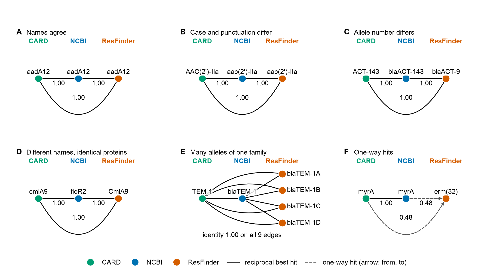
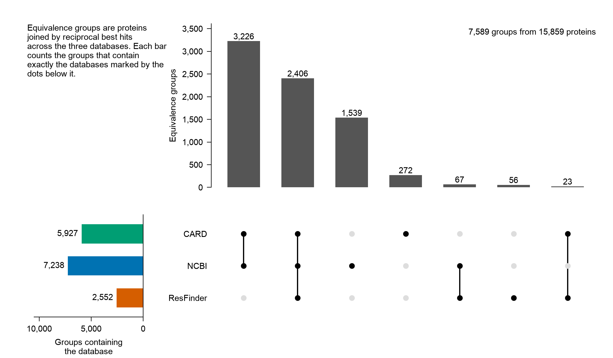
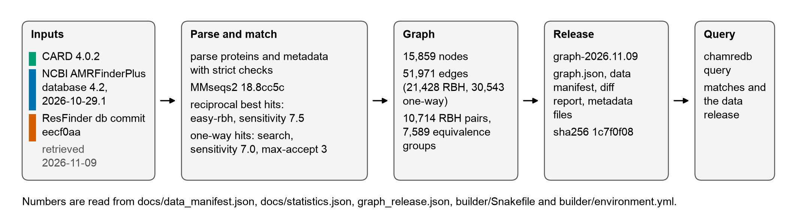
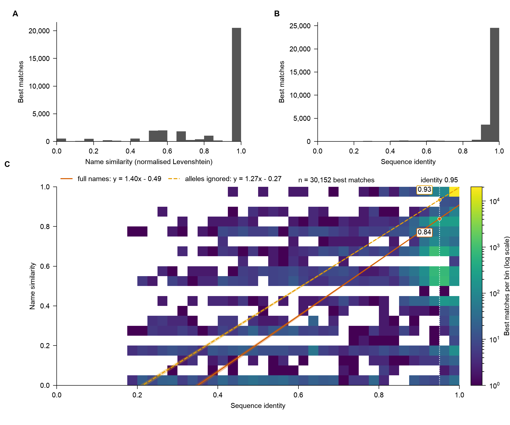
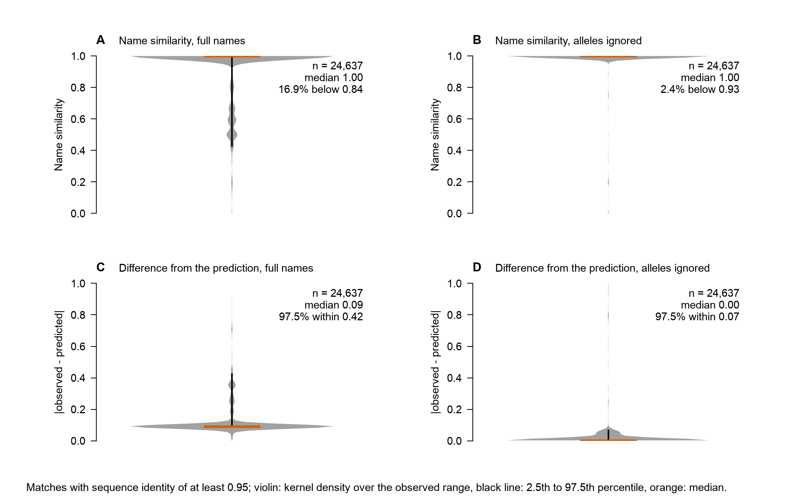
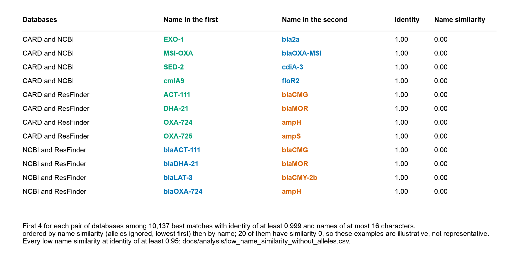
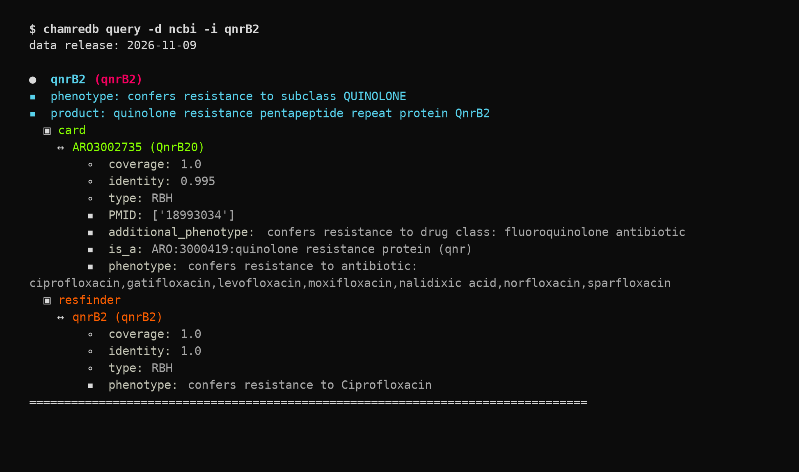
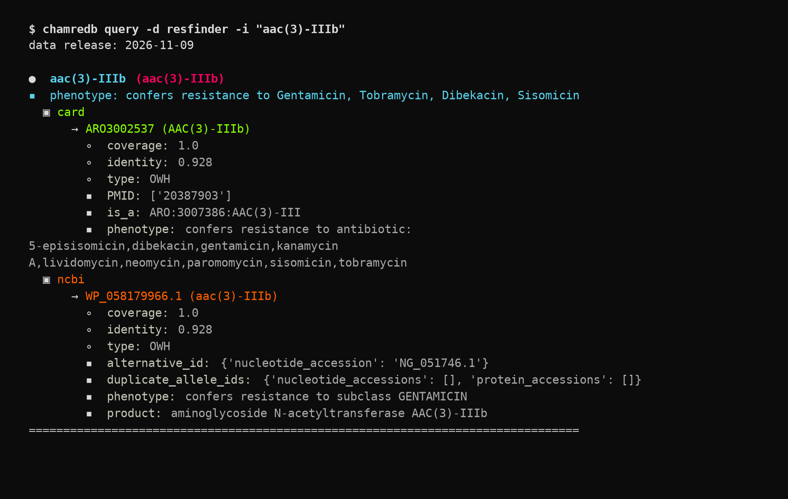

# CharmeDb

  
(pronounced 'charmed' `/tʃɑː(r)md/`)
  
Previously known as Project   

(Abandoned for obvious trademark issues and the fact that the joke may be lost on non-Brits)  

## Contributors
[Adam Witney](https://gitlab.com/awitney)  
[Alex Manuele](https://gitlab.com/alexmanuele)  
[Inês Mendes](https://gitlab.com/cimendes)  
[Thanh Le Viet](https://gitlab.com/thanhleviet)  
[Trestan Pillonel](https://gitlab.com/tpillone)  
[Varun Shamanna](https://gitlab.com/varunshamanna4)  

## Introduction

This project originated from the dilemma a scientist faces when choosing a database that stores antimicrobial resistance determinants. Multiple databases exist with comparative strengths and weaknesses. This project builds on the concepts of the [hAMRonization](https://github.com/pha4ge/hAMRonization) project aiming to aggregate and combine the information contained within the metadata associated with each project. The problem is exacerbated by the fact that the equivalent antimicrobial resistance genes (ARGs) can be named differently in each database.

The hypothesis for the project is as follows:  

* given a match in one database
* find the matches in other databases
* aggregate the combined descriptive information pertaining to antimicrobial resistance contained in the union of the metadata
* report this to user for them to make intelligent informed choices

## At a glance



The same protein often carries a different name in each database (panels B to D), and many proteins exist in only some of them. Of the <!-- stat:groups.total -->7,589<!-- /stat --> groups of proteins linked by reciprocal best hits, only <!-- stat:groups.all_three -->2,406<!-- /stat --> (<!-- stat:groups.all_three_share -->32%<!-- /stat -->) contain all three databases.



## Methodology

* Download sequences and associated metadata of ARGs from 3 databases
  * [CARD](https://card.mcmaster.ca/) ([Manuscript](http://www.ncbi.nlm.nih.gov/pubmed/31665441))
  * [NCBI AMR Reference Gene Catalog](https://www.ncbi.nlm.nih.gov/pathogens/refgene/)
  * [Resfinder 4](https://bitbucket.org/genomicepidemiology/resfinder/src/4.0/) ([Manuscript](https://academic.oup.com/jac/article/75/12/3491/5890997))  
   Details can be found in the [appendices](/docs/appendices.md#data-download)
* Parse the data to
  * extract the protein sequences and write into fasta format with the gene identifiers as the record ids.
  * extract the associated metadata and convert to a consistent `JSON` format  
   Details can be found in the [appendices](/docs/appendices.md#data-parsing)
* Find best matches of each gene from one source database against the other two target databases
  * Where a reciprocal best hit (RBH) exists, report this.  
     Details can be found in the [appendices](/docs/appendices.md#analyse-for-reciprocal-best-hits-rbhs).  
     A summary of the results can be found [here](/docs/appendices.md#summary-of-rbh-analysis)
  * If a RBH does not exist, report the best match as long as thresholds for coverage and indentity are met.
    A summary of the results can be found [here](/docs/appendices.md#summary-of-non-rbh-searches)
  
  For this purpose the [MMseqs2](https://pubmed.ncbi.nlm.nih.gov/29035372/) search tool was used that in its most sensitive mode is 100x faster than blastp and almost as sensitive. In a [comparative manuscript](https://pubmed.ncbi.nlm.nih.gov/33099302/) demonstrated that even in the worst cases MMseqs2 would not miss more than 10% of the RBH produced by blastp. MMseqs2 also contains a convenient wrapper to perform the all-by-all search necessary to find RBHs.

* From the outputs of the MMseqs2 searches the RBHs or best matches of each gene from one database against the other two databases can be parsed to produce a `Directed Graph`. This network was constructed using the [networkx](https://networkx.org/) python package.  
  Details of the method can be found [here](docs/appendices.md#building-a-networkx-graph)  
  In this graph
  * the nodes represent a protein from one database
    * Node attributes contain the phenotype from the JSON metadata
  * the edges link nodes and represent the matches and attributes include
    * type, either RBH or OWH (one way hit)
    * coverage, (alignment length/query length)
    * identity, (percent identity of match)  



The numbers in this figure are read from the release's manifest and statistics, so they match the graph described below.

## Current data release

The graph shipped with this version of the package is the release of **2026-11-09**. It was built from

| Database | Release |
| --- | --- |
| CARD | 4.0.2 (sequences and ontology from the same release) |
| NCBI AMRFinderPlus | database 4.2, 2026-10-29.1 |
| ResFinder | db 2.6.0, commit `eecf0aa` |

using MMseqs2 18.8cc5c (reciprocal best hits `easy-rbh -s 7.5`, one-way hits `search -s 7.0 --max-accept 3`). The graph is built by `builder/` (see the [builder tests](builder/tests/README.md)); the exact input files, with source URL and sha256, are listed in the `data_manifest.json` of the release.

| | Count |
| --- | --- |
| Nodes (proteins with at least one match) | <!-- stat:graph.nodes -->15,859<!-- /stat --> |
| Directed edges | <!-- stat:graph.edges -->51,971<!-- /stat --> (reciprocal best hits <!-- stat:graph.edges_rbh -->21,428<!-- /stat -->, one-way hits <!-- stat:graph.edges_owh -->30,543<!-- /stat -->) |
| Reciprocal best hit pairs | <!-- stat:graph.rbh_pairs -->10,714<!-- /stat --> |
| Equivalence groups (proteins joined by reciprocal best hits) | <!-- stat:groups.total -->7,589<!-- /stat --> |

The version of the data a result came from is printed by `chamredb query` (`data release:`) and written to the last column (`data_release`) of the TSV output. The earlier 2021 graph (11,718 nodes, 33,632 edges) can be rebuilt with `builder/reproduce_2021/`. How the graph grew from 2021 to this release, step by step, is in [docs/release-2026-11-09.md](docs/release-2026-11-09.md).

## Assessing the graph

How well do database names agree where the sequences match? For every protein the best match in each other database was found (the match with the highest coverage and identity, ties broken by edge order), and the two names were compared with the [normalised Levenshtein similarity](https://devopedia.org/levenshtein-distance#qst-ans-3), where 1 means identical names. Before the comparison each name was cleaned:

1. Removing species names from database names (CARD only), for example `Staphylococcus aureus mupB conferring resistance to mupirocin` becomes `mupB`
2. Conversion to lower case
3. Removing a leading `bla`
4. Removing parentheses
5. Removing hyphens

For the analysis that ignores alleles a trailing allele number is also removed (`qnrB20` becomes `qnrb`).

<!-- stat:analysis.matches -->30,152<!-- /stat --> best matches were analysed. A further <!-- stat:analysis.skipped -->1,349<!-- /stat --> were skipped because their target is the ResFinder entry `blaPAO`, a single entry that is the best ResFinder match of every one of the PDC alleles in CARD and NCBI, so comparing its name says nothing (the blaPDC alleles themselves are kept). Of the analysed matches, <!-- stat:analysis.high_identity -->24,637<!-- /stat --> have a sequence identity of at least 0.95.



Names agree more where sequences agree more, but not always. A linear regression of name similarity on sequence identity predicts a similarity of <!-- stat:analysis.full.predicted -->0.84<!-- /stat --> at identity 0.95 when names are compared in full, and <!-- stat:analysis.free.predicted -->0.93<!-- /stat --> when alleles are ignored (each analysis uses its own regression). Among the matches with identity of at least 0.95, <!-- stat:analysis.full.low_share -->16.9%<!-- /stat --> (<!-- stat:analysis.full.low_rows -->4,153<!-- /stat -->) have a name similarity at or below the full-name prediction, and <!-- stat:analysis.free.low_share -->2.4%<!-- /stat --> (<!-- stat:analysis.free.low_rows -->597<!-- /stat -->) when alleles are ignored. Most of the disagreement is therefore about alleles: the same gene family, a different allele number.



The tables of these matches are [docs/analysis/low_name_similarity.csv](docs/analysis/low_name_similarity.csv) and [docs/analysis/low_name_similarity_without_alleles.csv](docs/analysis/low_name_similarity_without_alleles.csv).

Some disagreements are not about alleles. These examples are proteins whose sequences are identical (identity of at least 0.999) and whose names share nothing once alleles are ignored; the caption explains how they were chosen and that they are illustrative, not representative.



All figures and tables in this section are made from the release graph by `python -m analysis.run --graph chamredb/data/graph.json --out docs --manifest docs/data_manifest.json`, with the data behind every figure in `docs/images/source_data_*`.

## Querying the graph

```
usage: chamredb query
  [-h]
  [-d {card,ncbi,resfinder}]
  [-ct COVERAGE_THRESHOLD] [-it IDENTITY_THRESHOLD]
  [--graph GRAPH]
  (-i ID | -f ID_FILE | -j HAMRONIZATION_JSON_FILE)
  [-o OUTFILE_PATH]
```

`--graph` uses a graph JSON file instead of the one shipped with the package (for example a newer release downloaded from the releases page), which also works offline.  

The graph can be queried in one of 3 ways  

### 1. Querying an individual

Requires specifying the identifier `-i` and database `-d`  

```
chamredb query -d ncbi -i WP_012695489.1 
```

Alternatively the gene name can be used

```
chamredb query -d ncbi -i qnrB2
```

The output reports the matches and metadata from the other databases  


Another example where the matches are one way hits not RBHs

```
chamredb query -d resfinder -i "aac(3)-IIIb"
```


In these outputs ↔ means a RBH, and ➡ a search hit

### 2. Providing a list of identifiers from a single database

Requires specifying the database `-d`, the text file containing the ids `-f`, and a path for the tsv output file `-o`  

```
chamredb query -d card -f docs/data/card_ids.txt  -o docs/data/card_ids.tsv
```

This will produce a [TSV file](/docs/data/card_ids.tsv) containing the matches and associated metadata with one row per id in the text file

### 3. Use hAMRonization summary output

Use the [hAMRonization software](https://github.com/pha4ge/hAMRonization) to convert the outputs from antimicrobial resistance gene detection tools into a unified format. Concatenate and summarize AMR detection reports into a single summary JSON file using the `hamronize summarize` command from this package. The JSON output from this step can be used to query ChamreDb.  
Use `-j` to specify the json summary file and `-o` the path for the TSV output  
**Please Note**  
Only outputs using data derived from AMR detection tools that have searched either the `CARD`, `NCBI` or `Resfinder 4` databases can be used.

```
chamredb query -j docs/data/hamronize_summary.json -o docs/data/hamronize_summary.tsv
```

This will produce a [TSV file](/docs/data/hamronize_summary.tsv) containing the matches and associated metadata with one row per id in the text file
