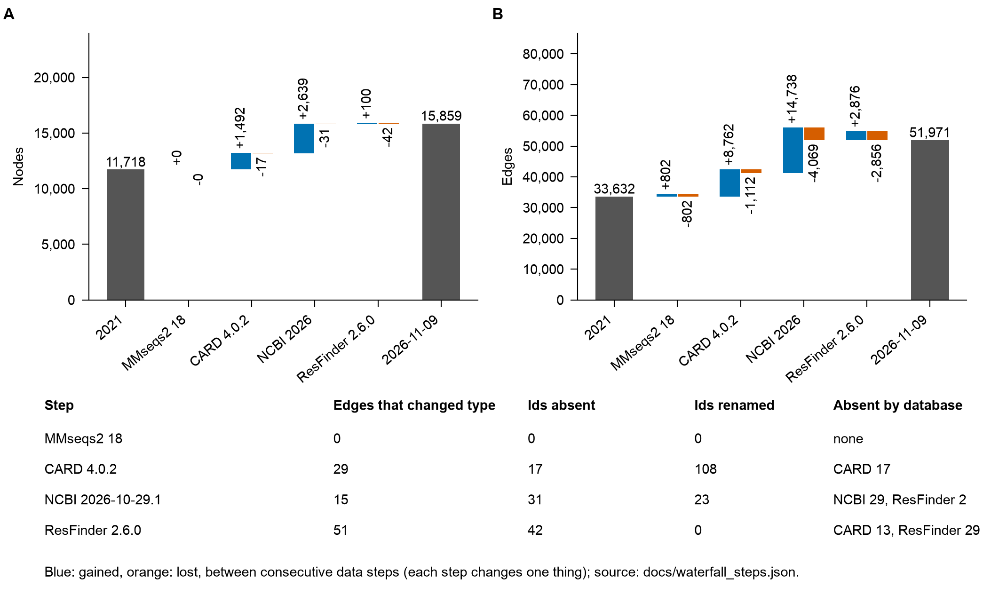

# From the 2021 graph to graph-2026.11.09

The graph changed in four steps, each changing one thing (ADR 0003): the search tool (MMseqs2 13.45111 to 18.8cc5c), then CARD (3.1.4 to 4.0.2), then NCBI AMRFinderPlus (2021-09-30.1 to 2026-10-29.1), then ResFinder (db commit of 2021-10-06 to 2.6.0, commit `eecf0aa`). Each step was reviewed as a diff report against the step before it (pull requests 28 to 31).



Source data: [`images/source_data_figure_release_waterfall.csv`](images/source_data_figure_release_waterfall.csv) and [`waterfall_steps.json`](waterfall_steps.json). The counts equal the reviewed reports (a test checks that, and that each step starts where the previous one ended).

| Step | Nodes | Edges | Graph sha256 (first 12) | Where the graph came from |
| --- | --- | --- | --- | --- |
| 2021 graph | 11,718 | 33,632 | `14e395c34426` | the graph shipped in 0.2.1, commit 359d3fe (chamredb/data/graph.json) |
| MMseqs2 18 | 11,718 | 33,632 | `513be26dfff1` | CI run 42624538261 (mmseqs2-upgrade, since removed): 2021 inputs, MMseqs2 18.8cc5c |
| CARD 4.0.2 | 13,193 | 41,282 | `a42fab77b37a` | CI run 42642062602 (refresh, candidate): CARD 4.0.2, NCBI and ResFinder 2021, MMseqs2 18 |
| NCBI 2026-10-29.1 | 15,801 | 51,951 | `d49e87256482` | CI run 42652988653 (refresh, candidate): CARD 4.0.2, NCBI 2026-10-29.1, ResFinder 2021 |
| ResFinder 2.6.0 | 15,859 | 51,971 | `1c7f0f080de1` | CI run 42666536631 (refresh, candidate): inputs of builder/refresh/inputs_resfinder.json; the release graph |

Each step graph was built by GitHub Actions from pinned inputs (`builder/reproduce_2021/inputs.json`, `builder/refresh/inputs_*.json`); the baseline graph of each refresh run is byte-identical to the previous step's graph, so the chain is consistent. To rebuild a step, run the `refresh` workflow with a baseline and a candidate inputs file (`gh workflow run refresh.yml -f baseline=... -f candidate=...`) and compare the two graphs with `builder/scripts/diff_graphs.py`. To regenerate the summary and the figure from the step graphs:

```
python -m analysis.waterfall --out docs/waterfall_steps.json \
  --step "2021 graph" PATH SOURCE --step "MMseqs2 18" PATH SOURCE --step "CARD 4.0.2" PATH SOURCE \
  --step "NCBI 2026-10-29.1" PATH SOURCE --step "ResFinder 2.6.0" PATH SOURCE
```

The step graph files themselves (about 10 to 14 MB each) are not committed. The GitHub Actions artifacts that held them expire after 90 days; the final graph is the release asset of `graph-2026.11.09`, and the 2021 graph is in the git history (commit `359d3fe`).
